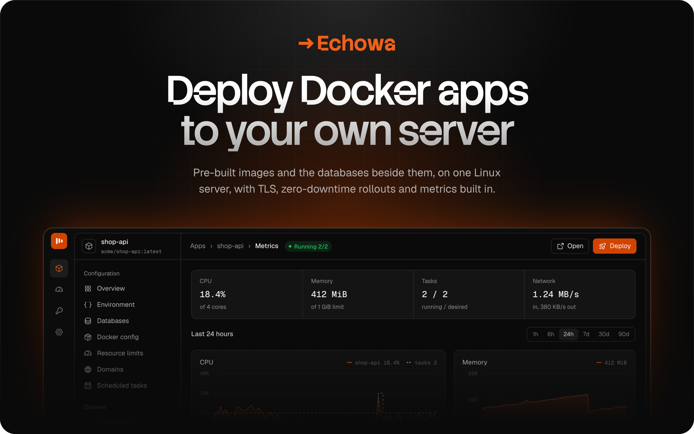
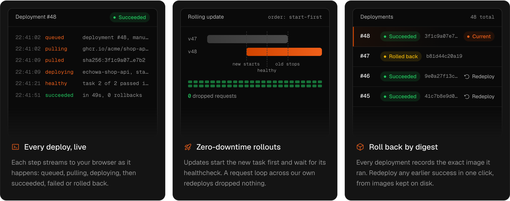
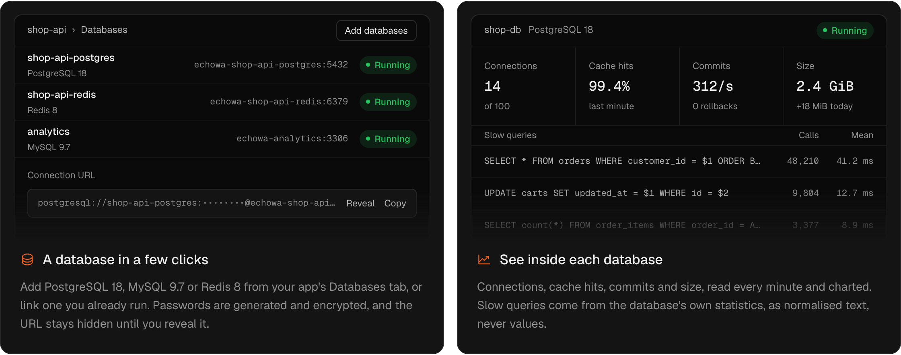
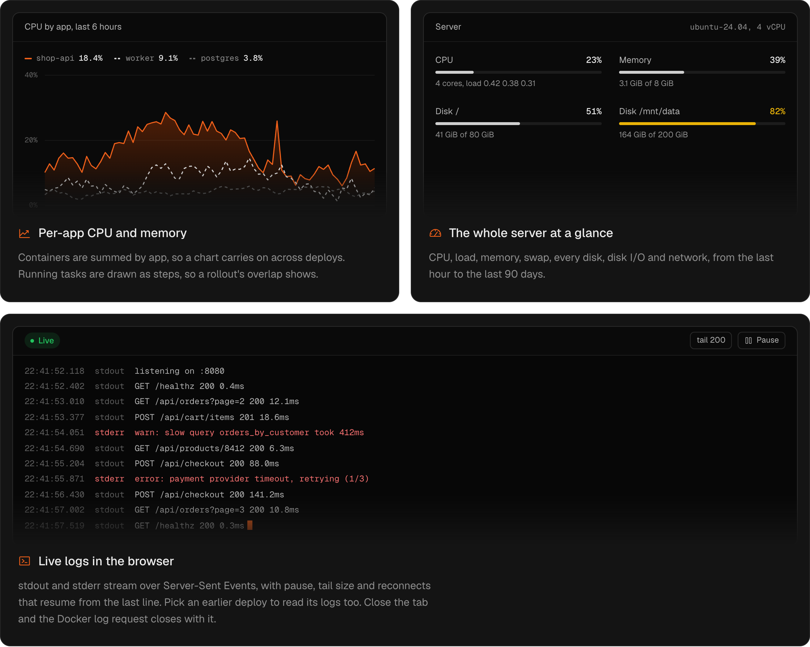
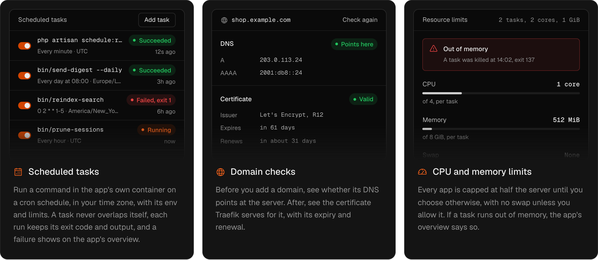
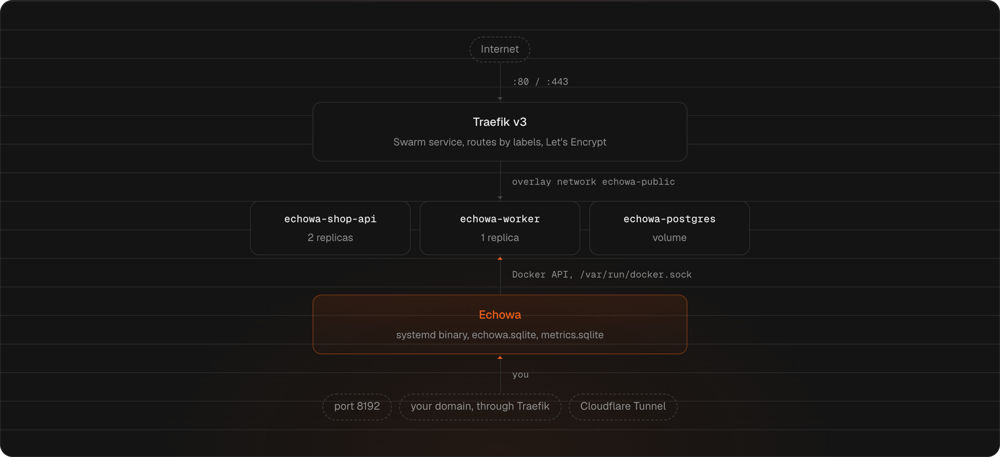
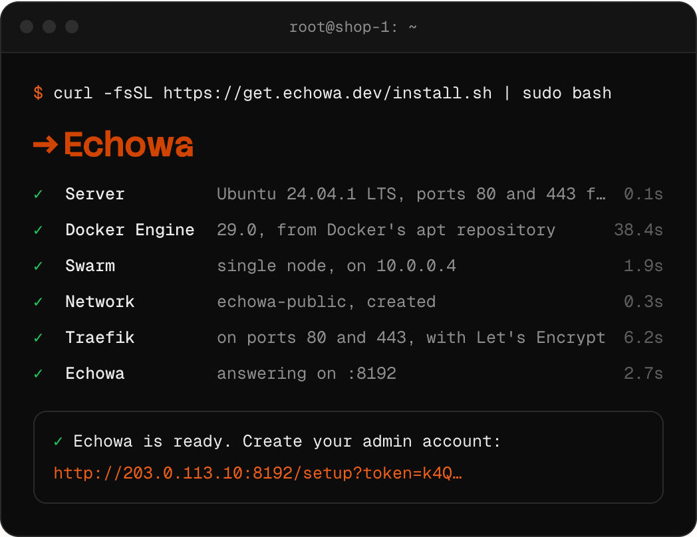

<a href="https://echowa.dev"></a>

<p align="center">
	<a href="https://get.echowa.dev/latest.json"></a>
	<a href="LICENSE.md"></a>
	
	
</p>

<p align="center">
	<a href="https://echowa.dev"><b>Website</b></a> ·
	<a href="deploy/README.md"><b>Install guide</b></a> ·
	<a href="https://echowa.dev/#compare"><b>Echowa, Coolify and Dokploy</b></a> ·
	<a href="https://github.com/pobl-software/Echowa/issues"><b>Report a bug</b></a>
</p>

<br>

Echowa is a small self-hosted deploy tool for one server. Your CI builds the
image. Echowa pulls it from GHCR or any registry, runs it as a Docker Swarm
service behind your domain with TLS, rolls it out without dropping a request,
and shows you the logs and metrics for every app and the server beneath them.

It's one Go binary and one SQLite file, beside Docker and Traefik. No control
plane, no Kubernetes, no agent to install.

```bash
curl -fsSL https://get.echowa.dev/install.sh | sudo bash
```

> [!NOTE]
> Echowa is young (0.x) and changes quickly, so expect rough edges.

<br>

## From registry to running, without a dropped request

Echowa pulls the image by digest, starts the new task beside the old one,
waits for its healthcheck, then moves traffic over. If the new version fails,
Swarm puts the old one back on its own. Every deploy records the image it
ran, so going back to any earlier one is a click.



## PostgreSQL, MySQL and Redis, beside your app

Start a database from a template and Echowa generates its passwords, gives it
a volume that survives redeploys, and checks its health every minute. Link it
to your app, copy the connection URL, and see what it's doing from the same
page. You can also open it on a host port, over TLS, for a client outside the
server.



## Metrics for the machine your apps live on

Every 15 seconds Echowa reads the host and every container from inside its
own process. No exporter, no Prometheus. Readings roll up hourly and daily,
so you can look back across the year. Logs stream to the browser live, for
the current deploy or the ones before it.



## The jobs around a deploy, on the app's own page

Cron jobs, domains and resource caps sit next to the app's deploys and logs,
instead of in a crontab, a DNS console and a config file on the server.



<br>

## Everything else one server needs

<table>
<tr>
<td width="33%" valign="top"><b>Automatic TLS</b><br>Give an app a domain and Traefik gets it a Let's Encrypt certificate.</td>
<td width="33%" valign="top"><b>Encrypted secrets</b><br>Env vars, database passwords and registry tokens are encrypted at rest. Pages get the keys, never the values, until you reveal one.</td>
<td width="33%" valign="top"><b>Private registries</b><br>GHCR or any registry. Credentials go only to that registry, per pull.</td>
</tr>
<tr>
<td valign="top"><b>Health you can trust</b><br>Every app's replicas are checked every 30 seconds, and an app is flagged after two minutes short.</td>
<td valign="top"><b>Image pruning</b><br>A daily prune keeps each app's last five successful deploys, so a rollback needs no pull.</td>
<td valign="top"><b>Signed updates</b><br>Releases are signed with minisign. Update from Settings, and one that won't start is rolled back, database included.</td>
</tr>
<tr>
<td valign="top"><b>Backups of Echowa itself</b><br>Its own database is backed up before every update, and daily if you ask.</td>
<td valign="top"><b>Your choice of access</b><br>Reach the UI over HTTP, HTTPS on your own domain, or a Cloudflare Tunnel.</td>
<td valign="top"><b>Locked from the start</b><br>No sign-up page. The installer prints a one-time link that creates the only admin.</td>
</tr>
</table>

## Does less, on purpose

Coolify and Dokploy are full platforms. They build from Git, run Compose
stacks and manage several servers, and if you need that, they're good
choices. Echowa is for when CI already builds your image and you want one
server you understand completely, with the numbers to show it's healthy.

<table>
<tr>
<th width="50%" align="left">What Echowa does</th>
<th width="50%" align="left">What it leaves out</th>
</tr>
<tr>
<td valign="top">

- Pulls pre-built images from GHCR or any registry
- Zero-downtime, healthcheck-gated rollouts on Docker Swarm
- Automatic TLS through Traefik and Let's Encrypt
- PostgreSQL, MySQL and Redis from templates
- Host, app and database metrics, with a year of history
- Live logs and live deploy output in the browser
- Scheduled tasks in your app's own container
- One-click rollback to any earlier digest

</td>
<td valign="top">

- Building images. Your CI does that
- Git providers and push-to-deploy
- Compose stacks and sidecars
- More than one server
- Preview environments per branch
- Backing up your apps' data
- Teams and roles. One admin, by design

</td>
</tr>
</table>

## Small enough to understand completely

Echowa sets labels on Swarm services and lets Docker and Traefik do what they
already do well. It runs under systemd as its own user, never inside Docker,
so it can't kill itself mid-deploy. Its data and its metrics are SQLite files,
so there's no database server to run beside it.



## Install

On a fresh Ubuntu or Debian server (Ubuntu 24.04 and 26.04 and Debian 12
and 13 are the tested ones, on amd64 or arm64), as a user with sudo:

```bash
curl -fsSL https://get.echowa.dev/install.sh | sudo bash
```

The installer asks how the UI should be reached, sets up Docker, a
single-node Swarm, Traefik and Echowa, then prints a one-time link to the page
that creates your admin account. Every step is safe to run again. Echowa owns
the server: Traefik takes ports 80 and 443.

<p align="center">
	
</p>

You choose one of three ways to reach the UI:

1. **HTTP on port 8192.** The default, for trying it out.
2. **HTTPS on your own domain,** through Traefik with a Let's Encrypt
   certificate on port 8192, so you can firewall the UI apart from your apps.
3. **A Cloudflare Tunnel.** The safest: Echowa stays on loopback, behind
   Cloudflare Access.

Read [deploy/README.md](deploy/README.md) before you install on anything that
matters. It covers the firewall, DNS, flags for unattended installs, backups
and upgrades.

<details>
<summary><b>Where things live on a server</b></summary>
<br>

| What                                           | Where                                                                                                    |
| ---------------------------------------------- | -------------------------------------------------------------------------------------------------------- |
| The binary, and the one before the last update | `/usr/local/bin/echowa`, `/usr/local/bin/echowa.previous`                                                |
| Artisan as Echowa's user                       | `sudo echowa-artisan <command>` (`/usr/local/bin/echowa-artisan`)                                        |
| Settings, including `APP_KEY`                  | `/etc/echowa/env`. Back up `APP_KEY` apart from the database: encrypted values can't be read without it. |
| Database, sessions, logs                       | `/var/lib/echowa` (`echowa.sqlite`, `storage/`). Logs also in `journalctl -u echowa`.                    |
| Backups                                        | `/var/backups/echowa`: daily with `--with-backups` (kept 14 days), and one before every update           |
| Traefik route for the UI (HTTPS access)        | `/etc/echowa/traefik/echowa.yml`                                                                         |
| Services                                       | `echowa.service`, `echowa-update.path` and `.service` (the root updater), `echowa-backup.timer`          |
| Update requests and status                     | `/var/lib/echowa/update/`                                                                                |

</details>

## Licence

Echowa is source-available under the
[Functional Source License, Version 1.1, ALv2 Future License](LICENSE.md)
(FSL-1.1-ALv2). In plain terms:

- **You can** use it, read it, change it and run it on your own servers,
  including for your business and for clients you do work for.
- **You can't** offer it, or something built from it, as a commercial
  product or service that competes with Echowa, such as a paid hosted
  version.
- **Each release becomes Apache 2.0** two years after it's published, with
  no restrictions beyond Apache's.

This summary isn't the licence; [LICENSE.md](LICENSE.md) is. The Echowa
name and logo aren't licensed for other uses. Some features may later be
offered under a separate commercial licence. [NOTICE](NOTICE) lists the
code Echowa started from and its licence, and `echowa licenses` prints the
licences of all the third-party software a release includes.

## Contributing and support

Bug reports and feature requests are welcome as
[GitHub issues](https://github.com/pobl-software/Echowa/issues). Pull
requests aren't accepted for now: [CONTRIBUTING.md](CONTRIBUTING.md) says
why and how to report a bug well.

Found a security problem? Don't open an issue. [SECURITY.md](SECURITY.md)
says how to report it privately.

<details>
<summary><b>Development</b></summary>
<br>

Needs Go, Node and [OrbStack](https://orbstack.dev). Echowa runs in an
OrbStack Ubuntu machine with its own Docker and Swarm, set up by
`deploy/dev-vm.sh`.

```bash
cp .env.example .env
go run . artisan key:generate
npm install
deploy/dev-vm.sh up
printf '%s\n' 'choose-a-password' | deploy/dev-vm.sh artisan user:create --email you@example.com --password-stdin
npm run dev                    # in one terminal
air                            # in another: http://localhost:3000
```

Deployed apps are reached at `http://<app>.localhost:8090`. `make check`
runs every check, and `make build` makes a release binary for this machine.
`scripts/readme/render.cjs` redraws the images in this README from
[echowa.dev](https://echowa.dev).

Built on [Goravel](https://www.goravel.dev) with an Inertia + React frontend.

</details>
